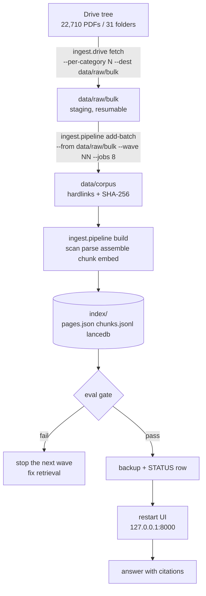

# Guide: download the remaining PDFs to 20,000, then use them in the RAG

Date: 2026-11-22. Companion to `reports/20k-ingestion-plan.md` (the plan and its gates) and
`RUNBOOK.md` (day-to-day operation). This file is the *procedure*: the commands, in order,
with the real expected output at each one.

Everything here uses code that already ships. **No new script, flag or dependency is needed**
for the download or the ingest; the 8-way parse is shipped as `--jobs` (§6.1). Where a
number is a projection it says so; a projection is not a result (AGENTS.md rule 4).

---

## 0. The numbers this guide is built on

| Fact | Value | Status |
|---|---|---|
| Drive tree (folder id `1ew-Pj4ry2vIzYpFMA3h3LiGZT-87YvnP`) | **22,710 PDFs** in **31 leaf folders** | **measured** 2026-11-22 (`ingest.drive plan --per-category 999999`) |
| Files per leaf folder | min 3, median 195, max 5,500 (`reports/CGIAR`) | **measured** |
| Corpus today | 187 PDFs in `data/corpus/`, index 186 documents / 2,669 pages / 11,334 chunks / 120 MB | `STATUS.md` (D-080) |
| Remaining to reach 20,000 | **19,813** | 20,000 − 187 |
| Smallest `--per-category` that plans them | **2,649** → 19,814 planned | **measured** (same command) |
| Canary today | **33/55**, recall@5 45/48, MRR 0.839, `eval/gate.py` **fails** vs the accepted 37/55 | `eval/runs/2026-11-22-english-only/` |
| Disk free | 701 GB on `C:` | `df -h` 2026-11-22 |

The tree holds **2,710 more PDFs than the target**, so "download all the remaining" means
"download up to 20,000" — the cursor in §2 stops at the target instead of running to 22,710.

Measured rates used for every time below (Step 11 pilot, 118 documents, and Step 12):

| Stage | Measured rate | Source |
|---|---|---|
| Drive download | 29.6 files/min, 1.22 MB/file | Step 11: 210 files / 257.1 MB in 426 s |
| Parse, one document at a time | 9.0 s/doc at 14.8 pages/doc = **87.9 pages/min** | **measured** 2026-11-22, 20 docs / 296 pages |
| Parse, 8 documents at once | **134.3 pages/min** = **1.53x** | **measured** 2026-11-22, same 20 docs |
| Embed (bge-small, CPU), encode only | 18.8 ms/chunk at 8 torch threads, 17.7 ms at 16 | **measured** 2026-11-22, 600 chunks |
| Table detection share of one parse | **22%** (7.3 s of 32.6 s over 41 pages) | **measured** 2026-11-22 |
| Parse, Step 11 pilot (superseded above) | 1.17 s/page = 51.4 pages/min | Step 11, tail-heavy 119-doc sample |
| Embed, Step 11 pilot (includes LanceDB writes) | 0.0656 s/chunk | Step 11 |
| Chunks per page | 3.92 | Step 11 (8,910 / 2,275) |
| Bibliography (`qwen3.5:4b`) | 8.2 s/document | Step 11, re-timed with Ollama up |
| Parse child start (isolation cost) | 1.04 s/document | Step 12 |
| Crash isolation | 1 document failed, batch reached 119/119 | Step 12 |

---

## 1. The shape of the job

```
     Google Drive tree (31 leaf folders, 22,710 PDFs)
                     |
                     |  ingest.drive fetch  --per-category <cursor>  --dest data/raw/bulk
                     v
     data/raw/bulk/...            one staging tree, resumable, nothing touches the corpus
                     |
                     |  ingest.pipeline add-batch --from data/raw/bulk --wave NN --jobs 8
                     |    hash every staged file, refuse/ skip / hardlink into data/corpus
                     v
     data/corpus/...  (187 + N PDFs, same relative folders, SHA-256 per file, D-030)
                     |
                     |  the same command runs build: scan -> parse -> assemble
                     |      -> chunk -> embed        (bibliography is on demand, B.1)
                     v
     index/  pages.json  chunks.jsonl  parsed/  lancedb/  manifest.sqlite
                     |
                     +-->  eval/run_retrieval.py + eval/gate.py   (did quality survive?)
                     +-->  scripts/recheck-not-found.py           (did a refusal become answerable?)
                     +-->  ingest.pipeline backup --out backups/wave-NN
                     |
                     |  restart the UI (it caches the page index in memory)
                     v
     ui/server.py on 127.0.0.1:8000  ->  generation.answer  ->  Ollama qwen3.5:4b
```

Mermaid, same picture, for a viewer that renders it:



**The wave loop, which is the whole discipline:**

```
wave NN:  fetch ~2,000  ->  add-batch --jobs 8  ->  build  ->  status  ->  canary gate
          ->  not-found recheck  ->  backup  ->  record in STATUS.md
          ->  gate PASS?  next wave  :  STOP, fix, re-measure
```

Two things are deliberately *not* in that loop: moving `data/raw` originals (owner-only,
rule 5) and editing `eval/questions.jsonl` (owner-only, rule 13).

---

## 2. Step A — download (10 cursor waves, ~11 h total, unattended and resumable)

`ingest.drive` fills each *leaf folder* up to `--per-category` files that are not already in
`--dest`. So raising the cursor downloads only the new files: that is the wave mechanism,
and it needs no new code. The staging tree is `data/raw/bulk`, one tree for all waves, so
no file is ever downloaded twice.

### A.0 Preflight

```powershell
git status --short                                   # must print nothing (rule 14)
.venv\Scripts\python.exe -m ingest.pipeline status   # documents 186, embedded 186, failed 0
```

### A.1 Count the tree without downloading (safe, writes nothing)

```powershell
.venv\Scripts\python.exe -m ingest.drive plan --folder-id 1ew-Pj4ry2vIzYpFMA3h3LiGZT-87YvnP --per-category 999999 --dest data\raw\__count-only
```

**Expect:** first line `22710 PDFs to fetch (999999 per leaf folder)`, then one path per
file. `plan` only lists; it downloads nothing and creates no folder. Delete nothing — the
`__count-only` path is never created.

### A.2 The cursor for each wave

Computed from the real folder sizes, so each wave is ~2,000 files and the tenth lands on
20,032 planned:

| Wave | `--per-category` | Planned cumulative | New files |
|---|---|---|---|
| 01 | 85 | 2,012 | 2,012 |
| 02 | 197 | 4,016 | 2,004 |
| 03 | 348 | 6,020 | 2,004 |
| 04 | 502 | 8,022 | 2,002 |
| 05 | 680 | 10,025 | 2,003 |
| 06 | 880 | 12,025 | 2,000 |
| 07 | 1,087 | 14,029 | 2,004 |
| 08 | 1,394 | 16,032 | 2,003 |
| 09 | 1,795 | 18,032 | 2,000 |
| 10 | 2,822 | **20,032** | 2,000 |

If you would rather do it in one pass instead of ten, the single command is the same with
`--per-category 2649` (19,814 planned). **Ten waves are better**, because a download that
dies at file 9,000 costs nothing but a re-run, while ten waves let you ingest wave 01 while
wave 02 downloads — and ingestion is the slow part.

### A.3 Fetch wave 01

```powershell
.venv\Scripts\python.exe -m ingest.drive fetch --folder-id 1ew-Pj4ry2vIzYpFMA3h3LiGZT-87YvnP --per-category 85 --dest data\raw\bulk
```

**Expect** (measured on the 210-file pilot, scaled): `2012 PDFs to fetch (85 per leaf
folder)`, then `[1/2012] data\raw\bulk\papers\01_Floods_GLOFs\...pdf` per file,
`done: ~1,990 added, ~20 duplicates skipped; manifest at logs\drive-pilot.jsonl`.
Time **~68 min** for 2,012 files (29.6 files/min), ~2.4 GB.

What it guarantees: every row in `logs/drive-pilot.jsonl` carries `drive_id`, `bytes`,
`sha256`, `downloaded` and `link: staged`; a file that is not a PDF (`%PDF-` in the first
1 KB) or a truncated body raises and retries rather than landing. Nothing is mirrored into
`data/corpus` because `--dest` is not `data/raw` itself. Re-running the exact command is
safe: files already on disk are not downloaded again.

`--include-parked` is **off** on purpose: `_wrong_pdf` and other `_`-prefixed folders are
parked material and must not enter the corpus.

### A.4 Waves 02–10

Same command, next cursor. Nothing else changes:

```powershell
.venv\Scripts\python.exe -m ingest.drive fetch --folder-id 1ew-Pj4ry2vIzYpFMA3h3LiGZT-87YvnP --per-category 197 --dest data\raw\bulk
.venv\Scripts\python.exe -m ingest.drive fetch --folder-id 1ew-Pj4ry2vIzYpFMA3h3LiGZT-87YvnP --per-category 348 --dest data\raw\bulk
# ... 502, 680, 880, 1087, 1394, 1795, 2822
```

**Expect each:** `~2,000 PDFs to fetch`, `~68 min`, `~2.4 GB`.

### A.5 What you get at the end of Step A

- `data/raw/bulk/` : **19,814 planned**, **~19,600–19,800 unique** files after same-batch
  name duplicates and byte-identical files are skipped (pilot: 212 planned → 210 fetched →
  119 after 91 byte-identical to indexed documents, so expect roughly 1 % loss plus the 187
  documents the corpus already has).
- **~24 GB** on disk (19,814 × 1.22 MB). `data/raw` is hardlinked into `data/corpus`, so the
  corpus copy costs **0 bytes** extra.
- **~11 h** of wall time, unattended. Nothing is indexed yet; the system still answers
  exactly as it does today.

**Stop condition:** if a fetch prints `could not list Drive folder ... check that the folder
is shared with 'anyone with the link'`, the share changed. Stop; do not re-run repeatedly.

---

## 3. Step B — ingest one wave into the corpus and the index

```powershell
.venv\Scripts\python.exe -m ingest.pipeline add-batch --from data\raw\bulk --wave 01 --jobs 8
```

**Expect, in this order:**

1. `added ~1,990, unchanged ~0, skipped [{...}], refused []` — files already indexed by
   content are *skipped and listed*, not fatal (D-076 behaviour, 19 test cases).
   On wave 02 the line reads `added ~2,000, skipped ~2,012` because the whole `bulk` tree is
   walked each time and the earlier waves are now indexed. That is correct, just slower to
   start (it hashes the tree: ~1 min at 20k files).
2. Hardlinks into `data/corpus/` keeping the relative folder, one row per file in
   `logs/wave-additions.jsonl`, and `wave-01` recorded in the manifest's `meta` table.
3. `build` runs and prints per-stage progress. **~4.5 h for 2,000 documents** (~3.5 h parse
   at 134.3 pages/min for ~28,540 pages with `--jobs 8`, ~0.8 h embed for ~112,000 chunks;
   the bibliography is no longer run, §B.1). This is resumable: killing it costs the
   document in flight.

### B.1 The two cost levers, both now the default

- **The bibliography is no longer part of a wave.** `build` and `add-batch` run
  `scan,parse,assemble,chunk,embed` by default, so the 4B-model call per document (8.2 s
  measured, ~45 h over ten waves) happens only when you ask for it:
  `.venv\Scripts\python.exe -m ingest.bibliography build`
  Metadata is only the reference line in the evidence rail, and a document without a record
  keeps its file-name label (`ui/static/app.js` falls back `reference -> label -> doc`), so
  answers and citations do not change. **Not measured:** running it later over documents that
  are already `embedded`; it resumes per document by SHA-256, but no run has done that yet —
  try it on three documents first and record the result.
- **Parse eight at a time, never more.** `--jobs 8` is in the commands above. Measured
  **1.41x** through the real `build` (1.53x on a direct-child sample), and 8×1 / 8×2 / 16×1
  land within a second of each other, so a bigger number buys nothing.
- **Nothing else.** `--limit 5` exists for a smoke test; do not use it to "spread" a wave.

### B.2 What will go wrong, and what it looks like

| Symptom | Meaning | Action |
|---|---|---|
| 1 document `failed` with `crash: exit code 3221225477` | The known PyMuPDF ONNX access violation in `find_tables` (the NSO report) | Nothing. Step 12 isolates it: the rest of the batch reaches 119/119. Rate seen: 1 in 119 |
| `duplicate` with `duplicate_of` | Same bytes under another name, or ≥80 % of pages repeat an indexed document | Nothing is deleted. Review the list; a wave that is >3 % duplicates is a stop-and-fix (plan §6) |
| `refused: [...]` and exit 1 | A non-PDF, a name collision with different bytes, or a repeated name inside the batch | Nothing was placed. Fix the staged folder and re-run |
| `timeout: no result after 900 s; killed it` | Document slower than the watchdog (default 900 s ≈ 3× the slowest measured, 310 s) | Re-run with `--parse-timeout 1800` if it is a real 500-page report |
| 15–20 % of the wave is Nepali/Devanagari | The tree mixes languages; retrieval is English BM25 + `bge-small-en` | The 50 %-Latin rule (D-080) quarantines them after the build; better is to filter *before* embedding (§7) |

---

## 4. Step C — prove the wave did not break the system

Run these four in order after every wave. A wave with no recorded numbers did not pass.

```powershell
# C.1 integrity
.venv\Scripts\python.exe -m ingest.pipeline status --report

# C.2 frozen canary retrieval (55 questions, unchanged set)
.venv\Scripts\python.exe eval\run_retrieval.py --label wave-01-canary
.venv\Scripts\python.exe eval\gate.py --current eval\runs\<date>-wave-01-canary --baseline <last accepted run> --start <run at the start of the step>

# C.3 did a refusal become answerable? (D-027)
.venv\Scripts\python.exe scripts\recheck-not-found.py

# C.4 snapshot, so a bad wave is one command away from undone
.venv\Scripts\python.exe -m ingest.pipeline backup --out backups\wave-01
```

**Expect:**

- `status`: `embedded` = corpus count, `failed` 0 (or the known crash row), `pending` 0,
  every file with a SHA-256. Unreadable pages reported; the corpus is already at 2.2 %
  against D-020's 1–2 % band, so this is monitoring, not a new gate.
- `gate.py`: this is where the corpus size really bites. **Today's canary is already 33/55
  and the gate already fails** against the accepted 37/55 (§0). Adding 19,800 documents from
  the same 31 folders the current 187 came from will move it again: wave 01 alone moved 4
  questions, and the measured cause was not the new documents' *content* but BM25's own
  statistics — adding 2,275 pages changed IDF and length normalisation, and three of the
  eight broken questions had no wave document in their top 6 at all (D-079).
- `recheck-not-found.py`: each of the 7 unanswerable questions is re-tested against the new
  pages. A question that is now answerable is **proposed** for replacement to you; the file
  is yours (rule 13).

**Decision you need before wave 02** — the gate cannot be read against two different
baselines. Pick one:

- **(a) Re-baseline on the post-wave-01 corpus** (33/55, D-078) and accept that the *number*
  will drift down as the corpus grows; then the real per-wave quality signal is the wave gold
  set (§6), not the 55.
- **(b) Roll wave 01 back** (`backups/2026-11-22-pre-wave01`) and start the 20k build from the
  accepted 37/55 corpus.

My recommendation is **(a)**, for one measured reason: the 55-question canary was written for
97 documents, and its answers now sit in a corpus 200× larger, so holding it fixed to 37/55
would stop every wave for a metric that no longer describes the job. Keep it as a *drift
detector* (record the number, stop at a cliff), and judge the new documents with their own
gold questions. That is also what `reports/20k-ingestion-plan.md` §5.3 already assumes.

---

## 5. Step D — use the new corpus in the LLM RAG

The UI and CLI read the same index; only the UI caches it, so it must be restarted.

```powershell
# D.1 the model server (offline variables are set by the script)
.\scripts\launch-llm.ps1
curl.exe -s http://127.0.0.1:11434/api/tags

# D.2 the UI — stop the old one first if it is running
.\scripts\open-chat.ps1 -Start

# D.3 recent numbers, no browser needed
curl.exe -s http://127.0.0.1:8000/api/health      # documents / pages / ocr_pages / unreadable_documents

# D.4 the same pipeline from a terminal, one question
.venv\Scripts\python.exe -m generation.answer "What was the 24-hour rainfall depth at Tistung?"
```

**Expect:** `/api/health` reports the **new** document and page counts (if it still says 186,
the UI was not restarted). The terminal answer comes back `status: verified` with `[n]`
markers and a citation line, p50 ~12 s / p95 ~28 s on this machine.

`POST /api/chat` takes `{"messages":[{"role":"user","content":"..."}],"use_cache":true}` and
streams one JSON object per line: `{"event":"start"}`, then `{"event":"token","text":...}`,
then `{"event":"done","payload":{...}}`.

**What to expect from answer quality as the corpus grows** — measured, not hoped:

- Retrieval is page-level BM25 over 11,334 chunks today. It is ~2.5 ms p50 at 851 pages and
  grows **linearly**: the 2× measurement (1,702 pages) was 5.15 ms p50 / 7.16 ms p95 and
  95 MB RSS, which puts the plan's own **p95 > 300 ms trigger at ~80,000 pages
  (~9,100 documents)** — that is **wave 05**, not the end.
- A cross-encoder rerank of the top 10 is built and **off** (`CHAT_RERANK=1`): it restored
  37/55 on the wave-01 corpus but fails the gate by breaking table questions (D-081). Do not
  expect it to rescue a 20k corpus.
- The prompt budget is fixed by the 4 GB GPU (`num_ctx` 4,096). A bigger corpus must not
  mean more passage tokens: D-073 proved that adding a page's table rows overflows the
  context and the model refuses. **More documents ≠ more context per answer.**
- Documents mostly not in Latin script cannot be retrieved by an English question at all;
  15 of the 118 pilot documents were like that, and `Questions like "What did Nepal's 2025
  National Tiger Survey find?"` refuses even though the file is indexed.

---

## 6. What to expect, stage by stage, for the whole 20k job

| Stage | One wave (2,000) | All ten (19,814) | Basis |
|---|---|---|---|
| Download | ~68 min, ~2.4 GB | **~11 h, ~24 GB** | 29.6 files/min, 1.22 MB/file (measured) |
| add-batch (walk + hash) | 1–3 min | ~30 min total | walk cost grows with tree size (projected) |
| Parse, one document at a time (today's code) | ~7 h | **~54 h** | 87.9 pages/min × 285,455 pages (measured rate, projected corpus) |
| Parse, 8 at once (`--jobs 8`) | ~4.6 h | **~35 h** | 134.3 pages/min (measured 1.53x) |
| Embed (CPU, encode only) | ~0.8 h | **~6 h** | 18.8 ms/chunk × 1.1 M chunks (measured) |
| Bibliography | ~4.5 h | **~45 h** (skippable) | 8.2 s/document |
| **Whole build, today's code** | **~16 h** | **~105 h ≈ 4.4 days** | parse + embed + bibliography |
| **Whole build, 8-way parse, no bibliography** | **~5.4 h** | **~41 h ≈ 1.7 days** | 35 + 6, see §6.1 |
| Index on disk | +~1 GB | **~9.4 GB** (pages 561 MB, chunks 1.55 GB, parsed 3.0 GB, lancedb 4.3 GB) | plan §2 byte-per-page rates (projected) |
| Canary run (retrieval only) | minutes | — | `eval/run_retrieval.py` |
| Full 55-question generation run | **25–40 min** | per wave, or just after waves 1, 5, 10 | `RUNBOOK.md` §7 |
| GPU | unchanged: qwen3.5:4b, 4 GB VRAM, 50/50 CPU/GPU | | `nvidia-smi` |

The honest headline, after the 2026-11-22 measurement in §6.1: **the 4B-model metadata
calls still cost more than parsing** (45 h of 105 h), and dropping them plus parsing eight
documents at once brings the whole 20k build to **~41 h ≈ 1.7 days**, not 8.3. Disk is not a
constraint (701 GB free). The machine must stay awake — an earlier eval was corrupted by the
system sleeping (`STATUS.md`, q038).

### 6.1 Making it faster — measured 2026-11-22

The 51.4 pages/min behind the 8.3-day figure came from a tail-heavy 119-document pilot. A
20-document sample of the real corpus (296 pages, every 9th file) runs faster and shows what
parallelism is worth here. Every number below was measured with the shipped
`ingest.pipeline parse-one` child, so it is the same code path `add-batch` uses:

| Configuration | Docs | Wall clock | Throughput | Speedup |
|---|---|---|---|---|
| one at a time (today's `parse_stage`) | 20 | 202.2 s | 87.9 pages/min | 1.00x |
| 8 at once | 20 | 132.2 s | **134.3 pages/min** | **1.53x** |
| 8 at once, spread sample (every 22nd file) | 8 | 48.4 → 32.0 s | — | 1.51x |
| 4 / 8 / 16 at once, 1–2 threads each | 8 | 41.1 / 43.7 / 43.9 s | — | 1.64–1.75x |

Page counts were identical serial and parallel, so this is a throughput change, not a
extraction change. Four things follow, in the order they pay:

1. **Leave bibliography out of the build** — that is what
   `--stages scan,parse,assemble,chunk,embed` does. It removes **45 h** of the job and nothing
   the RAG needs in order to answer. `title`/`authors` in the UI fall back to the file name
   until `python -m ingest.bibliography build` is run later, on demand, for the documents you
   actually cite.
2. **Parse several documents at once — shipped as `--jobs N`.** `parse_stage` was a strictly
   serial `for` loop over `_run_isolated`; it now runs N children in a pool and records them
   in plan order, with **default 1** so nothing about an existing run changes.
   `ingest/test_pipeline.py` is 26/26 and `build`'s stdout is still one JSON summary. Measured
   through the real `build` on 20 corpus documents: **205.6 s (86.4 pages/min) at `--jobs 1`
   and 145.3 s (122.2 pages/min) at 8 — 1.41x, identical page totals.**
3. **Do not go past 8 workers.** 8×1, 8×2 and 16×1 threads all land within 1 s of each other
   (43.2–43.9 s on the same 8 documents): the children contend for memory bandwidth and for
   PyMuPDF's ONNX table detector, which ignores `OMP_NUM_THREADS`. On a 2,000-document wave the
   slowest document stops setting the wall clock (in the 20-doc sample one 64 s document was
   32% of the serial total), so treat **1.5x as the floor and ~1.7x as the likely wave figure**.
4. **Do not tune embedding threads.** 600 real chunks: 61.7 ms/chunk at 1 thread, 18.8 ms at 8,
   17.7 ms at 16 — the default 8 is already at the knee, and 6 threads' worth of extra speed is
   not worth a config knob.

**What is left, and its size.** Table detection is **22%** of a parse (7.3 s of 32.6 s over 41
pages), so skipping it on pages that do not look like tables could save at most ~7 h of the
35 h parse — and it would change the text the gold pages were written against, so it goes
through the EVAL gate in §4, not into this guide as a quick win. The remaining cost is text
extraction plus OCR, and OCR runs on every scanned page.

Realistic wall clock for the corpus,
projected at the measured rates (pages/doc 14.27 from 2,669 / 187):

| Corpus | Pages | Parse (8 at once) | Embed | Total |
|---|---|---|---|---|
| 5,000 documents | 71,381 | 8.5 h | 1.5 h | **~10 h** |
| 10,000 documents | 142,769 | 17.7 h | 2.9 h | **~21 h** |
| 20,000 documents | 285,455 | 35.4 h | 5.8 h | **~41 h** |

Download is I/O-bound and can run in the same window (11 h in total, wave by wave), so the
long pole is parsing. What cannot be deleted: the §4 gate after each wave, and the machine
staying awake.

Where the job will actually be decided, in order: (1) the gate read in §4, (2) the BM25
trigger at wave 05, (3) wave gold questions. Not disk, not the LLM.

---

## 7. How to improve this — ranked, with the evidence that ranks them

1. **Move lexical search to SQLite FTS5 (or LanceDB full text) before wave 05.** Measured
   linear growth says the p95 > 300 ms and 2 GB RSS triggers arrive at ~9,100 documents,
   i.e. inside wave 05. This is the one change that must happen *before* the corpus is big.
   Approval: a new step task; it does not touch the corpus or the gold data.
2. **Give the table route its own budget instead of adding rows to prose.** D-073 measured
   the failure exactly: a page's table rows *appended* to its passage made a 16,012-character
   prompt against a 4,096-token context, Ollama truncated, and four table questions flipped
   to not-found/unverified. The fix is rows **replacing** the prose window on the `table`
   route — not a bigger `num_ctx` (no VRAM for it).
3. **Re-try the reranker only after (2).** D-081's five failures are all table questions
   (q002, q025, q027, q046, q047): the reranker replaces BM25's correct #1 page with a worse
   one. Fix the table route first, then re-run `scripts/measure-rerank.py` (10 s to load,
   409 ms p50 per question on CPU) and the gate.
4. **Filter language at ingest, not after.** 15 of 118 pilot documents were Devanagari and
   cannot be hit by an English query; D-080 quarantined 29 documents *after* they were
   parsed, embedded and indexed. `scripts/find-non-english-docs.py` already measures the
   share, so the check belongs in `add-batch` as a refusal/skip, saving parse + embed time.
5. **Make bibliography lazy for real.** Plan option (c): extract a reference line only for
   documents an answer actually cites. That turns 46 h into minutes on the documents that
   matter, and it needs the "re-run one stage on an embedded document" path that §B.1 says
   is not measured yet.
6. **Deduplicate before embedding, by DOI/title, not only by bytes.** `reports/CGIAR` alone
   holds 5,500 files from one series; exact-byte and 80 %-page dedupe will catch the true
   copies, but a re-typeset report is a different PDF with the same content, and every copy
   adds a competing page to BM25.
7. **Parallelise parsing, carefully.** Parsing is one child process at a time today
   (1.04 s/document of that is child start-up). Two or three children would divide the
   ~125 h of parse time, but `find_tables` already uses ONNX threads and
   `multiprocessing` spawn stalled it once (1,442 s versus 309 s, Step 12). Measure on 20
   documents before believing it.
8. **Write the wave gold questions as you go** (25 per wave, `EVAL.md` process). This is the
   only part that cannot be automated honestly and it is the bottleneck; without it, "the
   new documents are searchable" is an opinion rather than a measurement.

---

## 8. Followups (in the order I would take them)

| # | Followup | Needs |
|---|---|---|
| 1 | Decide §4: re-baseline the canary at 33/55, or roll wave 01 back | owner decision |
| 2 | Paste the start approval for this work into `APPROVALS.md` (the download is network, rule 2/6) | owner, one line |
| 3 | Fetch wave 01 (cursor 85) and run the first real 2,000-document wave end to end | approval 2 |
| 4 | Re-run the §6 table on the real wave and replace the projections with measurements | a finished wave |
| 5 | Build the FTS5 lexical stage (item 1 above) and gate it on the 55 questions | new step |
| 6 | Table route: rows replace prose (`item 2`), then re-measure the reranker (item 3) | new step |
| 7 | Language filter inside `add-batch` + a `--limit` flag on `ingest.drive` so the 20,000 cap is one command | new step |
| 8 | Offline proof with the network off after the pilot wave and after the last wave | elevated shell |

Two of these are small enough to be one step: the `--limit` flag on `ingest.drive plan/fetch`
(a cap, so the cursor table becomes `--limit 19813` and no arithmetic is needed) and the
language refusal in `add-batch`.

---

## 9. Safety and rollback

- Nothing in §2 touches `data/corpus`, `index/` or `eval/`. A download that goes wrong costs
  bandwidth only, and re-running the same command resumes.
- `data/raw/` originals are never modified or moved (rule 5). The corpus is a hardlink
  mirror, so removing a wave's PDFs from `data/corpus/` reclaims nothing but the link.
- Before every wave: `ingest.pipeline backup --out backups\wave-NN` (~1 GB at the end of the
  job). To undo a wave: stop the UI, `restore --from backups\wave-NN`, and remove that
  wave's rows from `logs/wave-additions.jsonl` by recording which files it added.
- The 29 quarantined documents are recoverable: `logs/english-only-removed.jsonl` names every
  file, both paths and its SHA-256.
- Never edit `eval/questions.jsonl`, `data/raw/` or `data/corpus/` by hand (rules 5, 13).

---

## 10. The approval this guide needs

Rule 2 forbids downloads without an approved step. To run §2, add one line to
`APPROVALS.md` (owner-only file):

```
2026-11-22 | start | step 13 | owner
```

and commit it with an `OWNER:` message. The step file would be this guide plus
`reports/20k-ingestion-plan.md` §5 as its definition of done. Until that line exists, §2 is
a plan and only §A.1 (which downloads nothing) may be run.
