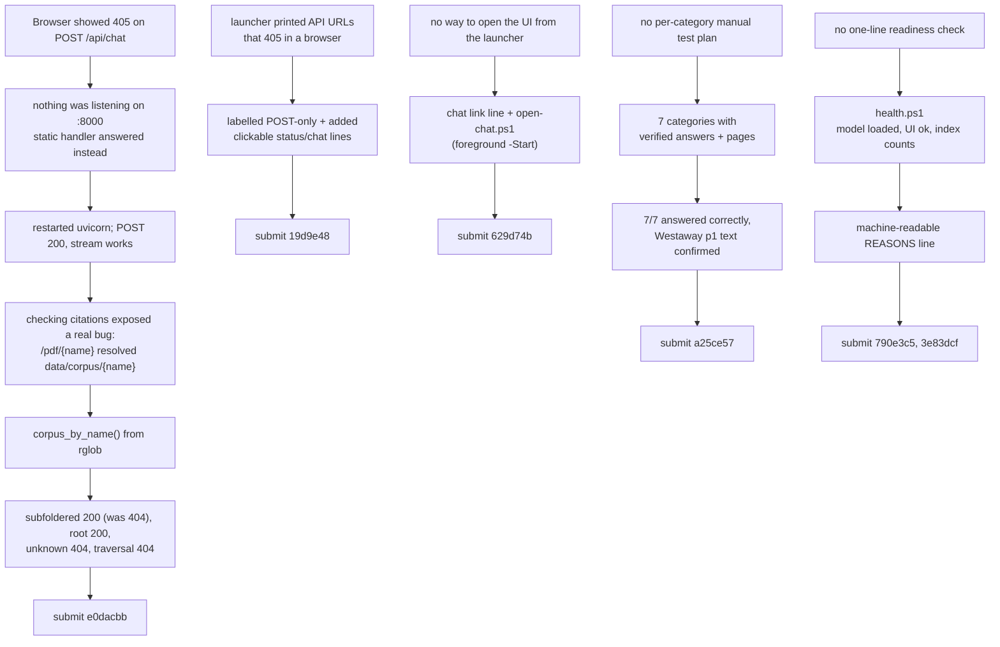
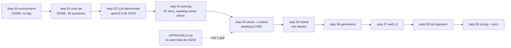

# Knowledge graph — RAG project

Three views of the same system: the data pipeline, this session's work, and where each step stands. The machine-readable twin is `reports/knowledge-graph.json` (nodes + edges, same ids).

Counts here are measured, not estimated: 97 documents, 851 pages, 242 tables, 3,226 chunks, 30 eval questions.

## 1. Pipeline — where data goes

```mermaid
flowchart LR
  RAW["data/raw<br/>originals, read-only"] -->|"hardlink, same folders (D-030)"| CORPUS["data/corpus<br/>97 PDFs, 851 pages"]
  CORPUS --> ING["ingest/cli.py<br/>parse, manifest, survive broken PDFs"]
  ING --> PARSED["data/parsed<br/>242 tables, 86 OCR pages"]
  PARSED --> STRUCT["chunk/structure.py<br/>headings (D-051)"]
  STRUCT --> TXT["chunk/text.py<br/>2,958 text chunks (D-052)"]
  STRUCT --> TAB["chunk/tables.py<br/>268 table chunks (D-053)"]
  TXT --> META["chunk/meta.py<br/>provenance prefix"]
  TAB --> META
  META --> CTX["chunk/doc_context.py<br/>qwen3.5:4b, 2-line context"]
  CTX --> IDX["index/chunks.jsonl<br/>3,226 chunks"]
  IDX --> EMB["benchmarks/embeddings<br/>CPU encode, 3 candidates"]
  EMB --> D054["D-054 PROPOSED<br/>bge-small-en-v1.5"]
  IDX --> BM25["eval/run_retrieval.py<br/>page BM25 baseline 25/26, MRR 0.885"]
  BM25 --> HYB["step 05 hybrid<br/>NOT STARTED"]
  D054 --> HYB
  HYB --> GEN["step 06 generation"]
  GEN --> UI["ui/server.py + ui/static<br/>chat on :8000, [A]-[D] chips"]
  CORPUS -->|"GET /pdf/{name}#page=N"| UI
```

The important edge is `BM25 -> HYB`: every dense configuration measured so far scores **below** the page-level BM25 baseline (25/26, MRR 0.885), so Step 5 has to combine the two rather than replace BM25.

## 2. This session's work — symptom, cause, fix, commit

## 3. Steps and approvals

## 4. Key measurements behind the graph

| Claim | Number | Source |
|---|---|---|
| Corpus size | 97 docs, 851 pages, 242 tables, 86 OCR pages | `index/ui-pages.json`, `STATUS.md` |
| Chunks | 3,226 = 2,958 text + 268 table, from 95 docs | `index/chunks.jsonl` |
| BM25 page baseline | recall@5 25/26, MRR 0.885 | `EVAL.md` |
| bge-small | 23/26, MRR 0.702 | `reports/embedder-comparison.md` |
| multilingual-e5-small | 23/26, MRR 0.723 | same |
| all-MiniLM-L6-v2 | 18/26, MRR 0.430 | same |
| Eval set | 30 questions, 26 answerable, 20 dev / 10 heldout, 7 types | `eval/questions.jsonl` |
| Unreadable pages | 20 of 851 (2.4%) | `STATUS.md` |

## 5. Node and edge tables

### Nodes

| id | kind | what |
|---|---|---|
| `raw` | data | `data/raw/` originals, read-only |
| `corpus` | data | `data/corpus/` 97 PDFs, mirrored folders |
| `parsed` | data | `data/parsed/` pages, blocks, tables |
| `chunks` | data | `index/chunks.jsonl` 3,226 chunks |
| `ingest` | module | `ingest/` parse + manifest + drive |
| `structure` | module | `chunk/structure.py` headings |
| `text` | module | `chunk/text.py` text chunks |
| `tables` | module | `chunk/tables.py` one table = one chunk |
| `meta` | module | `chunk/meta.py` provenance prefix |
| `doc_context` | module | `chunk/doc_context.py` LLM context per doc |
| `retrieval` | module | `ui/retrieval.py` page BM25 + OCR |
| `server` | module | `ui/server.py` FastAPI, streaming, `/pdf` |
| `static` | module | `ui/static/` chat UI, `[A]-[D]` chips |
| `bench` | module | `benchmarks/embeddings/run_embedder_bench.py` |
| `evalrun` | module | `eval/run_retrieval.py` official baseline |
| `launch` | script | `scripts/launch-llm.ps1` Ollama + links |
| `openchat` | script | `scripts/open-chat.ps1` open/start UI |
| `health` | script | `scripts/health.ps1` one-line readiness |
| `d030` | decision | corpus mirrors raw folders |
| `d043` | decision | UI built early, ungrounded at the time |
| `d044` | decision | page-level retrieval, lettered citations |
| `d045` | decision | OCR scanned pages at index build |
| `d051` | decision | heading detection rule |
| `d052` | decision | paragraph-atomic text chunk sizing |
| `d053` | decision | one table per chunk, excluded from text |
| `d054` | decision | **PROPOSED** bge-small embedder |

### Edges

| from | rel | to |
|---|---|---|
| `raw` | hardlinked into | `corpus` |
| `corpus` | parsed by | `ingest` |
| `ingest` | produces | `parsed` |
| `parsed` | sectioned by | `structure` |
| `structure` | feeds | `text`, `tables` |
| `text`, `tables` | annotated by | `meta` |
| `meta` | contextualised by | `doc_context` |
| `doc_context` | writes | `chunks` |
| `chunks` | embedded by | `bench` |
| `bench` | supports | `d054` |
| `chunks` | ranked by | `evalrun` |
| `corpus` | indexed by | `retrieval` |
| `retrieval` | serves | `server` |
| `server` | serves | `static` |
| `corpus` | served as PDF by | `server` |
| `launch` | prints link to | `server` |
| `openchat` | checks | `server` |
| `health` | checks | `server`, `launch`, `chunks` |
| `d030` | shapes | `corpus` |
| `d044` | shapes | `retrieval`, `server` |
| `d045` | shapes | `retrieval` |
| `d051` | shapes | `structure` |
| `d052` | shapes | `text` |
| `d053` | shapes | `tables` |
| `d054` | would shape | `bench`, step 05 |

## 6. Known gaps the graph makes visible

- `chunks` has no edge to a vector index yet — Step 4's index-size DoD item is unbuilt.
- `d054` is proposed, not accepted, so Step 5 has no chosen embedder.
- `retrieval` (page BM25) and `chunks` are two parallel paths that never meet; Step 5 is where they must.
- Legacy-font Nepali reports extract as Preeti and are effectively absent from `retrieval` (recorded in `reports/manual-test-questions.md`).
